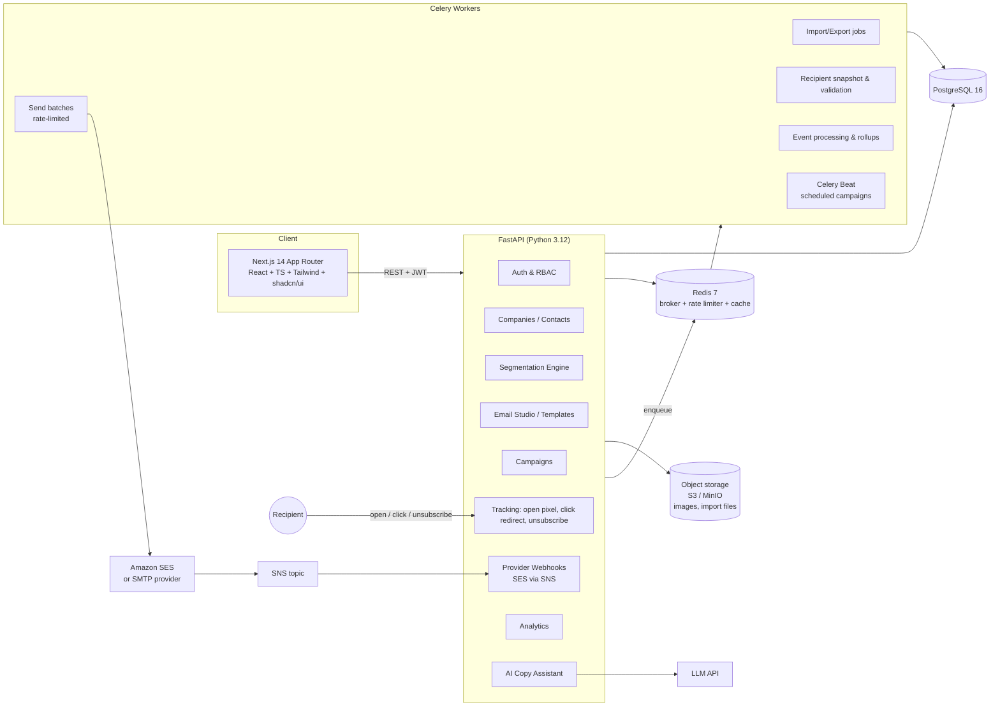
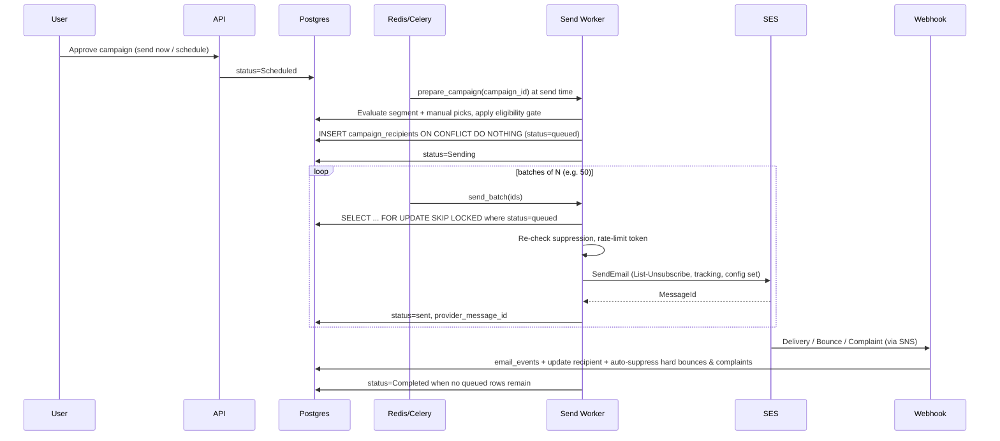

# 01 — System Architecture

Status: **PROPOSED — awaiting approval** (Phase 1)

## 1. Project inspection result

| Item | Finding |
|---|---|
| Target folder | `C:\Prime CFO\Prime CFO\Bulk Email Platefrom` |
| Existing files | None. Empty folder, so nothing is overwritten |
| Existing tech | None. Greenfield build |
| Tooling on dev machine (Cowork VM) | git 2.34, Node 22, Python 3.10 |
| Docker | Not detected in the VM; required on the developer machine for Postgres/Redis |

## 2. Architecture overview



## 3. Key design decisions (need your approval)

| # | Decision | Rationale |
|---|---|---|
| D1 | **Multi-tenant by `workspace_id`** on every business table, enforced in the service layer and backed by Postgres Row-Level Security | Prime CFO serves several clients. Each client gets an isolated workspace with its own contacts, suppressions and sending domains |
| D2 | **Monorepo**: `backend/` (FastAPI) + `frontend/` (Next.js) + `infra/` | One repo, one CI pipeline, shared OpenAPI contract |
| D3 | **SQLAlchemy 2.0 + Alembic** for ORM and migrations | Typed models, mature migrations |
| D4 | **Segments stored as a JSON rule tree** (nested AND/OR groups), compiled server-side to SQLAlchemy expressions | Safe, no raw SQL from users, unlimited nesting, live counts |
| D5 | **Recipient snapshot at approval**: `campaign_recipients` is frozen when a campaign is approved, with `UNIQUE(campaign_id, contact_id)` and `UNIQUE(campaign_id, lower(email))` | Guarantees no duplicate sends and gives an auditable record of who was eligible |
| D6 | **Eligibility gate checked twice**: at snapshot and again immediately before each send | Covers unsubscribes or bounces that happen while a campaign is in flight |
| D7 | **Provider abstraction** (`EmailProvider` interface) with `SESProvider` first, `SMTPProvider` second | Configurable provider as required |
| D8 | **Redis token-bucket rate limiter** per sending account (per-second and per-day caps from SES quota) | Respects SES limits; supports pause/resume |
| D9 | **Email editor: GrapesJS** (with the newsletter preset) for drag-and-drop, plus **TipTap** for the simple rich-text mode | GrapesJS produces table-based email HTML; TipTap gives a lightweight writer mode. Final HTML is inlined with `premailer`/`juice` |
| D10 | **Personalisation via a sandboxed Jinja2 environment** mapping `{{FirstName}}` style variables, with fallbacks (`{{FirstName|there}}`) | Safe rendering, no code execution |
| D11 | **Arabic/RTL**: template-level `direction` (`ltr`/`rtl`) and `lang` attributes; RTL-aware blocks; Arabic web-safe font stack | Required for KSA/GCC audiences |
| D12 | **Credentials encrypted at rest** (Fernet with key from env / AWS KMS in production); never returned by the API | Secure provider credential handling |
| D13 | **Auth: JWT access (15 min) + rotating refresh tokens (httpOnly cookie)**, Argon2id password hashing | Standard, secure |
| D14 | **Analytics from `email_events` with daily rollup table** (`campaign_daily_stats`) refreshed by workers | Fast dashboards without scanning raw events |

## 4. Repository structure

```
bulk-email-platform/
├── backend/
│   ├── app/
│   │   ├── main.py                # FastAPI app factory
│   │   ├── core/                  # config, security, logging, deps
│   │   ├── db/                    # session, base, RLS helpers
│   │   ├── models/                # SQLAlchemy models (one file per aggregate)
│   │   ├── schemas/               # Pydantic v2 request/response models
│   │   ├── api/v1/                # routers: auth, companies, contacts, ...
│   │   ├── services/              # business logic (segment compiler, eligibility, renderer)
│   │   ├── providers/             # email providers: base, ses, smtp
│   │   ├── workers/               # Celery app + tasks
│   │   └── tracking/              # pixel, click redirect, unsubscribe pages
│   ├── alembic/                   # migrations
│   ├── tests/                     # pytest (unit + integration against real Postgres)
│   ├── pyproject.toml
│   └── Dockerfile
├── frontend/
│   ├── src/app/(auth)/            # login
│   ├── src/app/(app)/             # dashboard, companies, contacts, segments, templates, campaigns, analytics, settings
│   ├── src/components/            # ui (shadcn), data-table, filters, charts, editor
│   ├── src/lib/                   # api client (generated from OpenAPI), auth, i18n
│   └── package.json
├── infra/
│   └── docker-compose.yml         # postgres, redis, minio, mailpit (local SMTP sink)
├── docs/                          # this architecture package
├── .env.example
└── README.md
```

## 5. Sending pipeline (Module 6)



Controls:
- **Idempotency**: row lock (`SKIP LOCKED`) plus `status` transitions `queued → sending → sent`; a retry never resends a `sent` row.
- **Retries**: transient provider errors (throttling, 5xx) use exponential backoff, max 5 attempts, then `failed`.
- **Pause/resume**: `campaign.status = Paused` stops workers from claiming new rows; resume re-enqueues remaining `queued` rows.
- **Suppression is non-bypassable**: enforced in `EligibilityService` which every send path calls; no API flag disables it.

## 6. Compliance model

- A contact is **eligible** only when all of these are true: `subscription_status = subscribed`, a valid `consent_records` entry exists (lawful basis + source + date), the email is not in `suppressions` (workspace or global), and `email_verification_status` is not `invalid`.
- Imported contacts default to `subscription_status = pending` unless the import maps a consent source and date. **Public business emails are not treated as consent.**
- Every email carries a one-click unsubscribe (RFC 8058 `List-Unsubscribe-Post`) and a footer link with the sender's physical address.
- Applicable regimes to configure per workspace: KSA **PDPL**, UAE PDPL, EU/UK **GDPR + PECR**, US **CAN-SPAM**.
- Settings page provides SPF/DKIM/DMARC records for each sending domain (pulled from SES `GetEmailIdentity`) and shows verification status.
